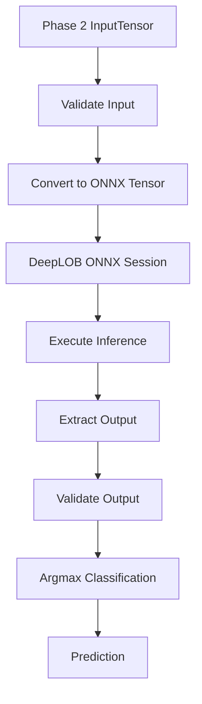

# PHASE_03.md — DeepLOB Inference Engine

## 1. Phase Overview

**Phase:** 03 — DeepLOB Inference  
**Branch:** `feat/deeplob-inference`  
**Objective:** Implement a functional Rust inference engine that loads the existing DeepLOB ONNX model, accepts preprocessed input tensors, performs inference through ONNX Runtime, and returns a three-class prediction.

### Project context

We are building a Rust alternative to the existing C++ inference implementation in `DeepLOB-HFT-Cpp`.

The Rust implementation will use:

- Rust stable
- Cargo
- `ort` crate
- ONNX Runtime
- CPU Execution Provider
- Existing DeepLOB ONNX model
- Existing Phase 1 runtime/session infrastructure
- Existing Phase 2 preprocessing and tensor construction

### Scope boundaries

This phase implements DeepLOB inference only.

**In scope:**
- DeepLOB model loading through the existing runtime layer.
- ONNX input/output metadata validation.
- Input tensor integration.
- Inference execution.
- Output extraction and validation.
- Argmax classification.
- Unit and integration tests.

**Out of scope:**
- TransformerLOB inference — Phase 4.
- CLI workflows — Phase 5.
- Benchmarking and performance profiling — Phase 6.
- Numerical equivalence and final validation — Phase 7.
- Model training or ONNX model export.
- GPU execution.
- Candle, Burn, or tch.
- Reimplementing the DeepLOB architecture in Rust.
- Modifying the preprocessing pipeline from Phase 2.

---

## 2. Existing System Contracts

Do not change these contracts without identifying a genuine incompatibility in the existing repository.

### Input tensor

The Phase 2 pipeline produces:

| Property | Expected value |
|---|---|
| Data type | float32 |
| Shape | `[1, 1, 100, 40]` |
| Layout | Contiguous, row-major |
| Total elements | 4,000 |
| Sequence length | 100 |
| Features per timestep | 40 |

The inference engine must consume this tensor directly.

It must not repeat normalization, feature extraction, or window generation.

### Output classes

The model produces three class scores.

| Class index | Meaning |
|---|---|
| 0 | Down |
| 1 | Stationary |
| 2 | Up |

The output scores are treated as logits unless inspection of the actual ONNX model establishes otherwise.

The predicted class is the index with the highest score.

### Important rule

Inspect the actual ONNX model before assuming its input/output names, tensor layout, output shape, or data type.

The expected input shape and class mapping are project contracts, but actual model metadata must be verified.

---

## 3. Target Architecture

Keep inference logic separate from runtime initialization, preprocessing, and application interfaces.

Proposed structure:

```text
src/
├── runtime/
│   ├── mod.rs
│   ├── session.rs
│   └── ...
│
├── models/
│   ├── mod.rs
│   ├── deeplob.rs
│   └── metadata.rs
│
├── inference/
│   ├── mod.rs
│   ├── engine.rs
│   ├── input.rs
│   ├── output.rs
│   ├── prediction.rs
│   └── error.rs
│
├── tensor/
│   └── ...                 # Existing Phase 2 implementation
│
└── main.rs
```

This is a proposed structure. Inspect the existing project before creating or moving files. Reuse Phase 1 and Phase 2 modules rather than duplicating them.

### Module responsibilities

| Module | Responsibility |
|---|---|
| `models/deeplob.rs` | DeepLOB model definition and model-specific metadata |
| `models/metadata.rs` | Model input/output metadata representation |
| `inference/engine.rs` | Inference engine and execution orchestration |
| `inference/input.rs` | Convert validated Rust tensors into ONNX Runtime inputs |
| `inference/output.rs` | Extract and validate model outputs |
| `inference/prediction.rs` | Prediction result and class mapping |
| `inference/error.rs` | Inference-specific error types |

---

## 4. Implementation Tasks

### Task 1 — Inspect Existing Infrastructure

Before writing code, inspect:

1. Phase 1 runtime/session implementation.
2. Phase 2 tensor representation and validation.
3. Existing configuration structure.
4. Actual DeepLOB ONNX model.
5. Current `ort` crate version and API.
6. Existing tests and error-handling conventions.

Determine:

- Actual ONNX input name.
- Actual ONNX output name.
- Input tensor type.
- Input tensor shape.
- Output tensor type.
- Output tensor shape.
- Whether the model returns logits or probabilities.
- Whether dynamic dimensions are present.

Do not invent missing metadata.

**Deliverable:** A short metadata inspection report and an implementation plan consistent with the actual repository.

### Task 2 — Define DeepLOB Model Metadata

Create a model-specific representation for DeepLOB.

It should capture the information required to validate and execute inference:

- Model identifier.
- Input name.
- Expected input element type.
- Expected input dimensions.
- Output name.
- Expected output element type.
- Expected output dimensions.
- Number of output classes.

Use actual metadata obtained from the ONNX session wherever possible.

Avoid scattering model names, dimensions, and class counts throughout the codebase.

**Acceptance criteria:**
- DeepLOB metadata is defined in one place.
- Runtime metadata can be compared against expected contracts.
- Invalid metadata produces descriptive errors.

### Task 3 — Implement Input Tensor Adapter

Implement the adapter between the Phase 2 tensor representation and ONNX Runtime.

Expected input:

```text
InputTensor
    shape: [1, 1, 100, 40]
    data: contiguous float32 values
```

Responsibilities:

1. Accept the validated Phase 2 tensor.
2. Verify its shape.
3. Verify the number of elements.
4. Verify the tensor is valid.
5. Construct the appropriate ONNX Runtime tensor.
6. Preserve the original feature and timestep ordering.
7. Pass the tensor using the actual ONNX input name.

Do not introduce unnecessary copies.

If the `ort` API permits ownership transfer or safe borrowing, use the most appropriate supported approach. Do not use unsafe code merely to avoid a copy.

**Acceptance criteria:**
- Correct shape reaches ONNX Runtime.
- Input data remains in the expected order.
- Incorrect shapes are rejected before inference.
- Invalid or non-finite input values are handled according to the project's validation policy.

### Task 4 — Implement DeepLOB Inference Engine

Implement the core engine.

Suggested conceptual API:

```rust
pub struct DeepLOBEngine {
    // Reusable ONNX Runtime session
}

impl DeepLOBEngine {
    pub fn load(model_path: &Path) -> Result<Self>;

    pub fn predict(
        &self,
        input: &InputTensor,
    ) -> Result<Prediction>;
}
```

Adapt signatures to the existing project conventions and the actual `ort` API.

Responsibilities:

1. Load the DeepLOB ONNX model.
2. Initialize or reuse the Phase 1 session infrastructure.
3. Validate model metadata.
4. Accept an input tensor.
5. Convert it into ONNX Runtime input.
6. Execute the model.
7. Extract the output.
8. Validate output dimensions and values.
9. Return a structured prediction.

**Important performance rule:**

Load the ONNX model once and reuse its session.

Do not create a new session for every prediction.

Model loading must never happen inside the prediction hot path.

### Task 5 — Implement Output Extraction

Create a dedicated output-processing module.

The implementation must:

1. Locate the expected output.
2. Extract the output tensor.
3. Validate the output data type.
4. Validate the output dimensions.
5. Verify that exactly three class scores are available.
6. Reject NaN or infinite scores.
7. Preserve the original class ordering.

The implementation must not silently accept unexpected output shapes.

If the ONNX model has a batch dimension, account for it explicitly rather than assuming a flat output.

**Expected conceptual output:**

```text
[
    down_score,
    stationary_score,
    up_score
]
```

This is illustrative. Use the actual output shape from the ONNX model.

### Task 6 — Implement Prediction and Classification

Create a structured prediction type.

Suggested representation:

```rust
pub enum Direction {
    Down,
    Stationary,
    Up,
}

pub struct Prediction {
    pub class_index: usize,
    pub direction: Direction,
    pub scores: [f32; 3],
}
```

Implement:

- Argmax classification.
- Class-index mapping.
- Access to raw model scores.
- Prediction validation.

Classification:

```text
0 → Down
1 → Stationary
2 → Up
```

For equal scores, define deterministic tie-breaking behavior. Prefer the lowest class index unless the existing C++ implementation establishes a different convention. Document the choice.

Do not apply softmax unless the project explicitly requires probabilities. Softmax is unnecessary for choosing the highest-scoring class when the outputs are logits.

### Task 7 — Integrate Error Handling

Use the existing error-handling strategy.

Add errors for:

| Error | Meaning |
|---|---|
| ModelLoadError | ONNX model could not be loaded |
| MetadataMismatch | Model metadata differs from expected contract |
| InvalidInputShape | Input dimensions are incorrect |
| InvalidInputData | Invalid or non-finite input values |
| InputConversionError | Input could not be converted to ONNX tensor |
| InferenceExecutionError | ONNX Runtime execution failed |
| MissingOutput | Expected model output was not found |
| InvalidOutputShape | Output dimensions are unexpected |
| InvalidOutputData | Output contains invalid values |
| PredictionError | Prediction could not be constructed |

Use `thiserror` if that is already the project's chosen error library.

Errors should contain useful context without exposing unnecessary internal implementation details.

---

## 5. Inference Execution Flow

The expected execution flow is:



The inference engine should not know how the original CSV was loaded or how normalization was performed.

Its responsibility begins with a validated tensor and ends with a validated prediction.

---

## 6. Testing Strategy

Testing is mandatory. Do not treat successful compilation as proof that inference works.

### A. Unit Tests

**Input adapter tests**
- Accept valid `[1, 1, 100, 40]` input.
- Reject incorrect dimensions.
- Reject incorrect element counts.
- Reject invalid values according to the validation policy.

**Metadata tests**
- Accept expected input metadata.
- Reject incorrect input types.
- Reject incompatible dimensions.
- Reject missing expected input/output metadata.

**Output tests**
- Accept three valid scores.
- Reject missing outputs.
- Reject incorrect output shapes.
- Reject NaN and infinite values.
- Verify class ordering.

**Prediction tests**

| Scores | Expected prediction |
|---|---|
| `[0.9, 0.1, 0.2]` | Down |
| `[0.1, 0.9, 0.2]` | Stationary |
| `[0.1, 0.2, 0.9]` | Up |
| `[0.9, 0.9, 0.1]` | Down, if lowest-index tie-breaking is used |

### B. Integration Tests

Use the actual DeepLOB ONNX model if it is available.

Tests should verify:

1. Model loads successfully.
2. Input metadata matches the expected contract.
3. A valid tensor executes successfully.
4. Output contains three valid scores.
5. A valid prediction is produced.
6. Repeated predictions work using the same session.

If the actual model is unavailable, do not fabricate a model or claim real DeepLOB inference works. Use a small test-only ONNX fixture if practical and clearly distinguish fixture tests from actual model integration tests.

### C. Regression Tests

Ensure the implementation does not break:

- Phase 1 runtime initialization.
- Phase 1 model loading.
- Phase 2 tensor validation.
- Existing configuration and tests.

### D. Repeated Inference Test

Run multiple predictions using one loaded session.

Verify that:

- The session remains reusable.
- No model reload occurs between predictions.
- Results are valid for each input.
- Errors do not leave the engine in an unusable state.

---

## 7. Performance and Engineering Constraints

Phase 6 will handle formal benchmarking. However, Phase 3 must avoid obvious performance mistakes.

Follow these rules:

1. Reuse the ONNX Runtime session.
2. Do not reload the model per prediction.
3. Do not repeat preprocessing.
4. Avoid unnecessary tensor copies.
5. Avoid unnecessary heap allocations in the hot path.
6. Do not introduce global mutable state.
7. Keep inference execution separate from logging and CLI output.
8. Do not add concurrency or batching unless required by the actual model contract.
9. Keep CPU execution as the initial target.
10. Keep the inference API reusable by later CLI and benchmarking modules.

Do not prematurely optimize with unsafe Rust.

---

## 8. Git Workflow

### Branch

Create the branch:

```bash
git switch main
git pull --ff-only
git switch -c feat/deeplob-inference
```

Before switching branches, inspect and preserve any uncommitted work. Do not overwrite or discard unrelated changes.

Do not work directly on `main`.

### Commit strategy

Use small, atomic Conventional Commits.

Suggested commit sequence:

| Checkpoint | Example commit |
|---|---|
| DeepLOB model metadata | `feat(model): define DeepLOB metadata` |
| Input adapter | `feat(inference): add ONNX input tensor adapter` |
| Output extraction | `feat(inference): implement output extraction` |
| Prediction types | `feat(prediction): add DeepLOB class mapping` |
| Inference engine | `feat(inference): implement DeepLOB inference engine` |
| Error handling | `feat(inference): add inference error handling` |
| Unit tests | `test(inference): add DeepLOB inference unit tests` |
| Integration tests | `test(inference): add ONNX inference integration tests` |
| Documentation | `docs(inference): document DeepLOB inference engine` |

These are checkpoints, not mandatory commits. Combine or split them where appropriate, while keeping every commit buildable and meaningful.

Before each commit:

```bash
git status
git diff
cargo fmt --check
cargo test
```

Do not create empty commits or commit broken intermediate states.

### Pull request

When Phase 3 is complete:

1. Review the complete diff.
2. Run all quality gates.
3. Push `feat/deeplob-inference`.
4. Open a pull request against `main`.
5. Include implementation details, tests, known limitations, and model availability.
6. Do not merge automatically.

---

## 9. Quality Gates

Run the following before requesting review:

```bash
cargo fmt --check

cargo check

cargo test

cargo clippy --all-targets --all-features -- -D warnings

cargo build --release
```

Also verify:

- Actual DeepLOB ONNX model loads, if available.
- Actual input metadata is validated.
- Actual inference executes, if the model is available.
- Output shape and class mapping are correct.
- Repeated inference works.
- Phase 1 and Phase 2 tests remain green.
- No unrelated files or generated assets were committed.

---

## 10. Phase 3 Acceptance Criteria

Phase 3 is complete when:

- [ ] DeepLOB ONNX model can be loaded through the Rust runtime infrastructure.
- [ ] Model metadata is inspected and validated.
- [ ] Input tensor accepts the Phase 2 `[1, 1, 100, 40]` contract.
- [ ] Input conversion preserves data type, dimensions, and ordering.
- [ ] Inference executes through ONNX Runtime CPU.
- [ ] Output is extracted and validated.
- [ ] Three-class argmax classification works.
- [ ] Class mapping is correct: Down, Stationary, Up.
- [ ] Invalid inputs and outputs produce descriptive errors.
- [ ] The model session is reused across predictions.
- [ ] Unit tests pass.
- [ ] Integration tests pass when the actual model is available.
- [ ] Phase 1 and Phase 2 functionality remains intact.
- [ ] Formatting, Clippy, tests, and release build pass.
- [ ] Changes are committed on `feat/deeplob-inference`.
- [ ] A pull request against `main` is ready for review.

---

## 11. Instructions for Codex

You are implementing **Phase 3 only** of the Rust DeepLOB inference engine.

Follow these instructions strictly:

### Before implementation

1. Inspect the repository structure.
2. Read the completed Phase 1 and Phase 2 implementations.
3. Inspect the Git status and recent commit history.
4. Verify the installed Rust toolchain.
5. Inspect the actual DeepLOB ONNX model, if available.
6. Inspect the existing `ort` dependency version and its compatible API.
7. Determine the actual model input and output metadata.
8. Prepare a concise implementation plan before modifying files.

### Git requirements

- Create or switch to `feat/deeplob-inference`.
- Do not use a branch name containing `phase-03`.
- Never work directly on `main`.
- Preserve unrelated uncommitted changes.
- Commit work incrementally using Conventional Commits.
- Do not force-push.
- Do not automatically merge the pull request.

### Implementation requirements

- Reuse Phase 1 runtime/session infrastructure.
- Reuse Phase 2 tensor types and validation.
- Do not duplicate existing functionality.
- Use the existing ONNX model.
- Use ONNX Runtime CPU execution.
- Implement DeepLOB inference only.
- Keep the inference engine independent of CLI and benchmarking code.
- Follow the actual ONNX metadata rather than assuming input/output names.
- Write meaningful tests.
- Keep code modular and maintainable.
- Avoid unnecessary dependencies and unsafe code.

### Strict exclusions

Do not implement:

- TransformerLOB.
- Benchmarking.
- Performance dashboards.
- CLI workflows beyond what is needed for existing project integration.
- Model training or export.
- GPU support.
- Candle, Burn, or tch.
- New preprocessing functionality.

### Completion report

At the end, provide:

1. Summary of implemented functionality.
2. Final project structure.
3. Actual ONNX metadata discovered.
4. API and inference execution details.
5. Tests added and their results.
6. Quality-gate results.
7. Git branch name.
8. Commit hashes and messages.
9. Pull request status.
10. Any blockers or limitations, especially if the actual ONNX model was unavailable.

**Do not claim that DeepLOB inference is functional unless an actual model inference test has succeeded.**

The objective is a clean, reusable, production-oriented Rust DeepLOB inference engine that can later be extended with TransformerLOB in Phase 4.
