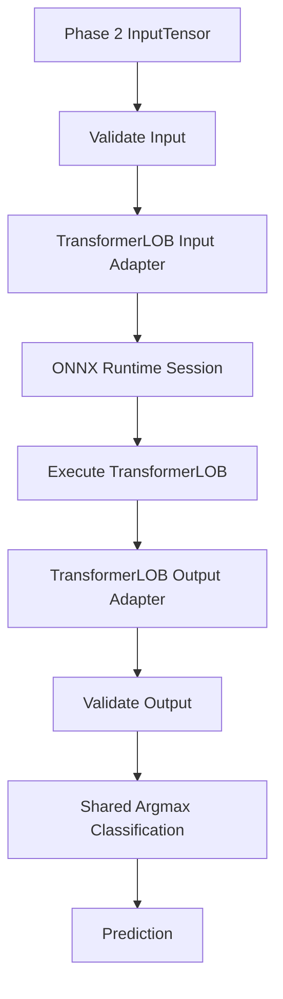

# PHASE_04.md — TransformerLOB Inference Engine

## 1. Phase Overview

**Phase:** 04 — TransformerLOB Inference  
**Branch:** `feat/transformerlob-inference`  
**Objective:** Implement TransformerLOB inference using Rust and ONNX Runtime, integrating it with the existing inference architecture without duplicating the DeepLOB implementation.

### Project context

We are building a Rust alternative to the C++ inference implementation in `DeepLOB-HFT-Cpp`.

The technology stack remains:

- Rust stable
- Cargo
- `ort` crate
- ONNX Runtime
- CPU Execution Provider
- Existing TransformerLOB ONNX model
- Phase 1 runtime/session infrastructure
- Phase 2 preprocessing and tensor infrastructure
- Phase 3 inference abstractions and prediction types

### Scope

**In scope:**
- TransformerLOB model loading.
- TransformerLOB-specific metadata validation.
- Input tensor compatibility.
- ONNX Runtime inference.
- Output extraction and validation.
- Three-class prediction.
- Integration with shared inference abstractions.
- Unit and integration tests.

**Out of scope:**
- DeepLOB modifications unless a shared abstraction requires a backward-compatible change.
- CLI workflows — Phase 5.
- Benchmarking — Phase 6.
- Numerical equivalence — Phase 7.
- Model training or export.
- GPU execution.
- Candle, Burn, or tch.
- Reimplementing TransformerLOB architecture in Rust.

---

## 2. Existing System Contracts

Phase 4 must preserve the contracts established in earlier phases.

### Input data

The existing Phase 2 tensor contract is:

| Property | Value |
|---|---|
| Data type | float32 |
| Shape | `[1, 1, 100, 40]` |
| Layout | Contiguous, row-major |
| Total elements | 4,000 |
| Sequence length | 100 |
| Features | 40 |

**Important:** Do not assume TransformerLOB accepts exactly the same ONNX input layout as DeepLOB. Inspect the actual TransformerLOB ONNX model.

If its input dimensions differ, implement a model-specific adapter or a clearly documented transformation from the Phase 2 representation. Do not silently reshape or reorder tensor data.

### Output classes

Preserve the project's class mapping:

| Class index | Meaning |
|---|---|
| 0 | Down |
| 1 | Stationary |
| 2 | Up |

Validate the actual TransformerLOB output shape and type before interpreting its values.

---

## 3. Architecture

The central architectural objective is to support multiple models without duplicating runtime and inference logic.

Proposed structure:

```text
src/
├── runtime/
│   └── ...                  # Phase 1
│
├── models/
│   ├── mod.rs
│   ├── deeplob.rs           # Phase 3
│   ├── transformerlob.rs    # Phase 4
│   └── metadata.rs
│
├── inference/
│   ├── mod.rs
│   ├── engine.rs
│   ├── input.rs
│   ├── output.rs
│   ├── prediction.rs
│   ├── error.rs
│   ├── deeplob.rs           # Existing Phase 3 implementation
│   └── transformerlob.rs    # New implementation
│
├── tensor/
│   └── ...                  # Phase 2
│
└── main.rs
```

This is a proposed structure. Follow the existing repository conventions and avoid unnecessary restructuring.

### Architectural principle

Separate model-specific behavior from shared inference functionality.

**Shared components:**
- ONNX Runtime session management.
- Input validation utilities.
- Output extraction utilities where compatible.
- Prediction representation.
- Class mapping.
- Common inference errors.
- Logging and tracing.

**TransformerLOB-specific components:**
- Model metadata.
- Input adapter, if required.
- Output adapter, if required.
- Model loading and validation configuration.
- TransformerLOB inference engine.

Do not force DeepLOB and TransformerLOB into an abstraction that makes their actual model contracts harder to represent.

---

## 4. Implementation Tasks

### Task 1 — Inspect TransformerLOB ONNX Model

Before implementation, inspect the actual TransformerLOB model.

Determine:

1. ONNX input names.
2. ONNX input count.
3. Input data types.
4. Input dimensions.
5. Dynamic dimensions, if any.
6. ONNX output names.
7. Output data types.
8. Output dimensions.
9. Number of output classes.
10. Whether outputs are logits or probabilities.
11. Whether additional inputs or preprocessing requirements exist.

Compare its metadata with DeepLOB.

Create a short metadata comparison:

| Property | DeepLOB | TransformerLOB |
|---|---|---|
| Input name | Inspect model | Inspect model |
| Input count | Inspect model | Inspect model |
| Input type | Inspect model | Inspect model |
| Input shape | Inspect model | Inspect model |
| Output name | Inspect model | Inspect model |
| Output shape | Inspect model | Inspect model |
| Output type | Inspect model | Inspect model |
| Class count | Verify | Verify |

Do not populate this table with guessed values.

**Deliverable:** TransformerLOB metadata inspection report.

### Task 2 — Define TransformerLOB Model Metadata

Create a TransformerLOB-specific model definition.

Suggested conceptual structure:

```rust
pub struct TransformerLOBMetadata {
    pub input_name: String,
    pub output_name: String,
    pub expected_input_shape: Vec<usize>,
    pub expected_output_shape: Vec<usize>,
    pub num_classes: usize,
}
```

Adapt this to the existing metadata design.

Requirements:

- Keep metadata separate from inference execution.
- Validate actual ONNX metadata.
- Handle dynamic dimensions explicitly.
- Reject incompatible tensor types.
- Reject unexpected input/output counts.
- Avoid hardcoding metadata in multiple modules.

If TransformerLOB has multiple inputs, represent and validate each input explicitly.

### Task 3 — Reuse and Refine Shared Inference Abstractions

Review the Phase 3 implementation.

Identify which components can be reused without modification and which require generalization.

Potential shared components:

- Common prediction structure.
- Class-index mapping.
- Output validation.
- ONNX Runtime session handling.
- Common error types.
- Model metadata validation utilities.

If necessary, introduce a shared model interface.

For example:

```rust
pub trait InferenceModel {
    fn predict(
        &self,
        input: &InputTensor,
    ) -> Result<Prediction>;
}
```

This is illustrative, not a mandatory API.

The final design must account for the actual differences between model inputs and outputs.

**Important:** Do not refactor the entire Phase 3 implementation just to introduce a trait. Prefer small, backward-compatible changes.

### Task 4 — Implement TransformerLOB Input Adapter

Implement the model-specific input conversion.

Expected source representation:

```text
Phase 2 InputTensor
    float32
    contiguous
    [1, 1, 100, 40]
```

The TransformerLOB adapter must:

1. Accept the validated Phase 2 tensor.
2. Check compatibility with the ONNX input contract.
3. Perform any required shape transformation only when supported by the model specification.
4. Preserve feature ordering.
5. Preserve timestep ordering.
6. Preserve numerical values.
7. Convert the tensor into the ONNX Runtime input representation.
8. Use the actual ONNX input name.

If TransformerLOB expects a different tensor layout, document the transformation precisely.

Do not:
- Re-normalize features.
- Re-extract features.
- Change the sequence length arbitrarily.
- Transpose dimensions without evidence.
- Add padding or truncation without a model requirement.
- Silently accept incompatible inputs.

**Acceptance criteria:**
- Input tensor is compatible with the actual model.
- Tensor dimensions and ordering are correct.
- Invalid inputs are rejected with descriptive errors.

### Task 5 — Implement TransformerLOB Inference Engine

Implement the TransformerLOB engine.

Suggested conceptual API:

```rust
pub struct TransformerLOBEngine {
    // Reusable ONNX Runtime session
}

impl TransformerLOBEngine {
    pub fn load(model_path: &Path) -> Result<Self>;

    pub fn predict(
        &self,
        input: &InputTensor,
    ) -> Result<Prediction>;
}
```

Adapt the API to the existing project.

Responsibilities:

1. Load the TransformerLOB ONNX model.
2. Reuse Phase 1 runtime infrastructure.
3. Validate model metadata.
4. Convert input using the TransformerLOB adapter.
5. Execute ONNX Runtime inference.
6. Extract model output.
7. Validate output.
8. Produce a structured prediction.

Use CPU Execution Provider.

**Performance requirement:** Load the session once and reuse it across predictions. Do not reload the model inside `predict()`.

### Task 6 — Implement TransformerLOB Output Adapter

Inspect the actual model output before implementing extraction.

The adapter must:

- Find the expected output by name.
- Validate output type.
- Validate output dimensions.
- Validate the expected number of class scores.
- Reject missing or unexpected outputs.
- Reject NaN and infinite values.
- Preserve the class ordering.

If the output has extra dimensions, handle them explicitly according to the actual model contract.

Do not assume that TransformerLOB has the same output layout as DeepLOB simply because both models predict three classes.

### Task 7 — Implement Prediction Integration

Reuse the shared prediction representation from Phase 3 wherever compatible.

Expected conceptual result:

```rust
pub struct Prediction {
    pub class_index: usize,
    pub direction: Direction,
    pub scores: [f32; 3],
}
```

Class mapping:

```text
0 → Down
1 → Stationary
2 → Up
```

Requirements:

- Preserve raw output scores.
- Use deterministic argmax.
- Keep tie-breaking consistent with Phase 3.
- Do not apply softmax unless explicitly required by the model contract.
- Do not create a separate incompatible prediction type without a strong reason.

### Task 8 — Error Handling

Reuse common inference errors where possible.

Add TransformerLOB-specific errors only when necessary.

Relevant cases:

| Error | Description |
|---|---|
| ModelLoadError | Model could not be loaded |
| MetadataMismatch | ONNX metadata differs from expected contract |
| UnsupportedInputLayout | Input layout is unsupported |
| InvalidInputShape | Input dimensions are incompatible |
| InputConversionError | Input could not be converted |
| InferenceExecutionError | ONNX Runtime execution failed |
| MissingOutput | Expected output is missing |
| InvalidOutputShape | Output dimensions are unexpected |
| InvalidOutputData | Output contains invalid values |
| PredictionError | Prediction could not be constructed |

Errors should clearly distinguish model-specific problems from common runtime failures.

---

## 5. Inference Execution Flow



The execution flow should remain independent of CLI and benchmarking functionality.

---

## 6. Testing Strategy

### A. Unit Tests

**Metadata tests**
- Correct metadata is accepted.
- Incorrect input types are rejected.
- Incorrect dimensions are rejected.
- Missing inputs and outputs are rejected.
- Dynamic dimensions are handled correctly.

**Input adapter tests**
- Correct Phase 2 input is accepted.
- Incompatible dimensions are rejected.
- Required layout transformation is correct, if applicable.
- Feature ordering is preserved.
- Timestep ordering is preserved.
- Invalid numerical values are rejected according to policy.

**Output adapter tests**
- Valid three-class output is accepted.
- Missing output is rejected.
- Unexpected dimensions are rejected.
- Invalid values are rejected.
- Class ordering is preserved.

**Prediction tests**
- Down prediction works.
- Stationary prediction works.
- Up prediction works.
- Tie-breaking matches Phase 3.

### B. Integration Tests

Use the actual TransformerLOB ONNX model when available.

Verify:

1. Model loads successfully.
2. Model metadata matches its expected contract.
3. Valid input reaches ONNX Runtime.
4. Inference executes successfully.
5. Output is extracted correctly.
6. Prediction is generated.
7. Repeated inference works using one session.

If the actual model is unavailable, use a clearly identified test-only ONNX fixture where practical.

Do not claim actual TransformerLOB inference works based solely on mock tests or successful compilation.

### C. Cross-Model Regression Tests

Ensure that adding TransformerLOB has not broken DeepLOB.

Verify:

- DeepLOB model still loads.
- DeepLOB input adapter still works.
- DeepLOB output extraction still works.
- DeepLOB predictions remain valid.
- Shared prediction types remain compatible.
- Phase 1 and Phase 2 tests still pass.

### D. Session Reuse Tests

Load TransformerLOB once and execute multiple predictions.

Verify that the same session can be reused and that inference does not trigger model reloading.

---

## 7. Engineering and Performance Constraints

1. Reuse ONNX Runtime sessions.
2. Do not reload models per prediction.
3. Avoid unnecessary tensor copies.
4. Avoid unnecessary heap allocations in the hot path.
5. Keep model-specific transformations outside shared code.
6. Preserve the existing DeepLOB implementation.
7. Keep CPU execution as the target.
8. Do not introduce GPU dependencies.
9. Do not implement batching unless the model contract requires it.
10. Do not add benchmarking infrastructure in this phase.
11. Avoid premature optimization and unsafe Rust.

Formal performance measurements belong to Phase 6.

---

## 8. Git Workflow

### Branch

Use:

```bash
git switch main
git pull --ff-only
git switch -c feat/transformerlob-inference
```

Before switching, inspect the working tree and preserve unrelated uncommitted changes.

Do not work directly on `main`.

### Commit strategy

Use atomic Conventional Commits.

Suggested sequence:

| Checkpoint | Example commit |
|---|---|
| Model metadata | `feat(model): define TransformerLOB metadata` |
| Shared abstractions | `refactor(inference): generalize shared inference components` |
| Input adapter | `feat(inference): add TransformerLOB input adapter` |
| Output adapter | `feat(inference): add TransformerLOB output adapter` |
| Engine | `feat(inference): implement TransformerLOB inference engine` |
| Error handling | `feat(inference): handle TransformerLOB-specific errors` |
| Unit tests | `test(inference): add TransformerLOB unit tests` |
| Integration tests | `test(inference): add TransformerLOB ONNX integration tests` |
| Documentation | `docs(inference): document TransformerLOB inference` |

Only make commits for meaningful, completed checkpoints. Keep commits buildable and avoid unrelated changes.

Before each commit:

```bash
git status
git diff
cargo fmt --check
cargo test
```

### Pull request

When complete:

1. Review the entire diff.
2. Run all quality gates.
3. Push `feat/transformerlob-inference`.
4. Open a PR against `main`.
5. Explain shared abstraction changes.
6. Include actual model metadata and test results.
7. List any limitations.
8. Do not automatically merge.

---

## 9. Quality Gates

Run:

```bash
cargo fmt --check

cargo check

cargo test

cargo clippy --all-targets --all-features -- -D warnings

cargo build --release
```

Additionally verify:

- Actual TransformerLOB model loads, if available.
- Actual model metadata is validated.
- Input adapter matches the actual ONNX contract.
- Inference executes successfully when the model is available.
- Output dimensions and class mapping are correct.
- Repeated inference works.
- DeepLOB tests remain green.
- Phase 1 and Phase 2 tests remain green.
- No model binaries, datasets, generated outputs, or build artifacts were accidentally committed.

---

## 10. Phase 4 Acceptance Criteria

- [ ] TransformerLOB ONNX metadata has been inspected.
- [ ] TransformerLOB model can be loaded using the existing runtime infrastructure.
- [ ] Model metadata is validated.
- [ ] Phase 2 tensor is accepted or transformed using a documented, verified adapter.
- [ ] Input ordering and numerical values are preserved.
- [ ] ONNX Runtime CPU inference executes successfully.
- [ ] Output is extracted and validated.
- [ ] Three-class prediction works.
- [ ] Class mapping matches Phase 3.
- [ ] Shared inference abstractions are reused where appropriate.
- [ ] DeepLOB implementation remains functional.
- [ ] Unit tests pass.
- [ ] Integration tests pass when the actual model is available.
- [ ] Repeated inference works with a reused session.
- [ ] Quality gates pass.
- [ ] Changes are committed on `feat/transformerlob-inference`.
- [ ] Pull request against `main` is ready for review.

---

## 11. Instructions for Codex

You are implementing **Phase 4 only** of the Rust inference engine.

### Before coding

1. Inspect the repository.
2. Read the completed Phase 1, Phase 2, and Phase 3 implementations.
3. Inspect the Git status and commit history.
4. Verify the Rust toolchain and current `ort` API.
5. Locate the actual TransformerLOB ONNX model.
6. Inspect its complete input/output metadata.
7. Compare its input/output contracts with DeepLOB.
8. Identify reusable Phase 3 components.
9. Prepare an implementation plan before modifying files.

### Git requirements

- Create or switch to `feat/transformerlob-inference`.
- Do not include `phase-04` in the branch name.
- Never work directly on `main`.
- Preserve unrelated user changes.
- Use incremental Conventional Commits.
- Do not force-push.
- Do not automatically merge the PR.

### Implementation requirements

- Reuse Phase 1 runtime infrastructure.
- Reuse Phase 2 tensor infrastructure.
- Reuse Phase 3 inference abstractions where appropriate.
- Inspect actual TransformerLOB ONNX metadata.
- Implement model-specific input/output handling.
- Preserve DeepLOB compatibility.
- Use ONNX Runtime CPU.
- Write meaningful unit and integration tests.
- Keep the architecture modular and maintainable.

### Strict exclusions

Do not implement:

- New DeepLOB features.
- CLI workflows.
- Benchmarking.
- Model training or export.
- GPU execution.
- Candle, Burn, or tch.
- New dataset preprocessing.
- Numerical equivalence benchmarking.

### Completion report

At completion, report:

1. TransformerLOB ONNX metadata discovered.
2. Differences between DeepLOB and TransformerLOB.
3. Shared components reused or refactored.
4. Final project structure.
5. Input/output adapter implementation.
6. Inference execution details.
7. Tests added and results.
8. Quality-gate results.
9. Branch name.
10. Commit hashes and messages.
11. PR status.
12. Any blockers or limitations.

**Do not claim successful TransformerLOB inference unless the actual ONNX model has been executed successfully.**

The final objective is a Rust inference system that supports both DeepLOB and TransformerLOB through a reusable ONNX Runtime architecture, with model-specific differences handled explicitly.
