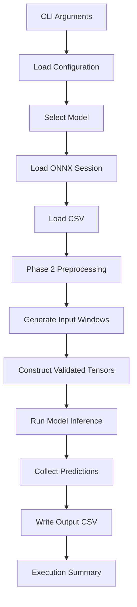

# PHASE_05.md — Inference CLI and Executables

## 1. Phase Overview

**Phase:** 05 — Inference Executables and CLI  
**Branch:** `feat/inference-cli`  
**Objective:** Build a production-oriented command-line interface that allows users to load either DeepLOB or TransformerLOB, run inference on input data, perform smoke tests, and save predictions.

### Project context

The Rust project replaces the C++ inference implementation in `DeepLOB-HFT-Cpp`.

The implementation must reuse:

- Phase 1 — ONNX Runtime integration and session management.
- Phase 2 — CSV loading, normalization, window extraction, and tensor construction.
- Phase 3 — DeepLOB inference engine.
- Phase 4 — TransformerLOB inference engine.

Technology stack:

- Rust stable
- Cargo
- `ort`
- ONNX Runtime CPU Execution Provider
- `clap` for CLI argument parsing
- `serde` and `toml` for configuration
- `csv` for CSV input/output
- Existing project logging and error handling

Inspect the existing dependencies before adding anything. Reuse existing crates where possible.

---

## 2. Scope

### In scope

1. Unified CLI architecture.
2. Model selection.
3. Runtime and model inspection commands.
4. Smoke testing.
5. CSV-based inference.
6. Prediction serialization.
7. Output CSV generation.
8. Basic benchmark command and execution interface.
9. Logging and error reporting.
10. CLI integration tests.

### Out of scope

- Implementing new model architectures.
- Model training or ONNX export.
- GPU execution.
- Candle, Burn, or tch.
- New preprocessing algorithms.
- Full performance profiling and optimization — Phase 6.
- Numerical equivalence validation against C++ — Phase 7.
- Web dashboard or graphical interface.
- Distributed inference.

---

## 3. CLI Design

Use a single executable with subcommands.

Suggested executable name:

```bash
lob-inference
```

The CLI should support:

```bash
lob-inference --help
lob-inference runtime-info
lob-inference inspect
lob-inference validate
lob-inference smoke-test
lob-inference predict
lob-inference benchmark
```

The existing Phase 1 commands should be preserved and extended rather than rewritten.

### Proposed command structure

| Command | Responsibility |
|---|---|
| `runtime-info` | Display ONNX Runtime information |
| `inspect` | Inspect model metadata |
| `validate` | Validate model compatibility |
| `smoke-test` | Run a minimal inference test |
| `predict` | Run inference on CSV data |
| `benchmark` | Execute repeated inference and report basic timing |

Use `clap` subcommands and structured argument types. Avoid parsing command-line arguments manually.

---

## 4. Configuration Architecture

Support configuration through a TOML file, with command-line overrides.

Suggested configuration:

```toml
[application]
name = "lob-inference"
log_level = "info"

[runtime]
execution_provider = "cpu"
intra_threads = 0
inter_threads = 0

[models.deeplob]
path = "models/deeplob.onnx"

[models.transformerlob]
path = "models/transformerlob.onnx"

[data]
input_path = "data/input.csv"
output_path = "outputs/predictions.csv"

[preprocessing]
sequence_length = 100
stride = 100
feature_count = 40
epsilon = 1e-8

[normalization]
mean_path = "data/normalization/mu.npy"
std_path = "data/normalization/sigma.npy"
```

This is an illustrative structure. Preserve the existing configuration format and field names from Phase 1 and Phase 2 wherever possible.

### Configuration requirements

- Support a default configuration.
- Allow a custom config path.
- Allow CLI arguments to override configuration values.
- Validate required paths.
- Validate model selection.
- Validate preprocessing settings.
- Produce descriptive errors for missing or invalid configuration.

Do not silently fall back to a different model or dataset.

---

## 5. Task 1 — Implement CLI Application Structure

Create a clear separation between CLI parsing and actual application logic.

Suggested structure:

```text
src/
├── cli/
│   ├── mod.rs
│   ├── args.rs
│   ├── commands.rs
│   └── handlers/
│       ├── mod.rs
│       ├── runtime_info.rs
│       ├── inspect.rs
│       ├── validate.rs
│       ├── smoke_test.rs
│       ├── predict.rs
│       └── benchmark.rs
│
├── application/
│   ├── mod.rs
│   ├── model_factory.rs
│   ├── inference_service.rs
│   └── output_writer.rs
│
├── runtime/
├── models/
├── inference/
├── preprocessing/
├── data/
├── tensor/
├── config/
└── main.rs
```

Adapt the structure to the existing codebase.

### Responsibilities

**CLI layer**
- Parse arguments.
- Validate basic argument combinations.
- Call application services.
- Display results and errors.

**Application layer**
- Load configuration.
- Select the model.
- Load preprocessing dependencies.
- Execute inference workflows.
- Write output files.

**Inference layer**
- Execute model inference.
- Return structured predictions.

The CLI must not contain model execution or preprocessing algorithms directly.

---

## 6. Task 2 — Model Selection and Model Factory

Support two models:

```text
deeplob
transformerlob
```

Suggested usage:

```bash
lob-inference predict --model deeplob
```

```bash
lob-inference predict --model transformerlob
```

Implement a model factory or equivalent application service.

Conceptual design:

```rust
pub enum ModelType {
    DeepLOB,
    TransformerLOB,
}
```

The factory should:

1. Receive the selected model type.
2. Resolve its configured ONNX model path.
3. Load the correct inference engine.
4. Validate the model.
5. Return a reusable inference service.

Use the existing Phase 3 and Phase 4 engines.

Do not duplicate ONNX session initialization or prediction logic.

### Acceptance criteria

- Both models can be selected independently.
- Each model uses its own configured ONNX file.
- Invalid model names are rejected.
- Missing model files produce clear errors.
- Model loading happens once per application run, not once per input window.

---

## 7. Task 3 — Runtime Information Command

Implement:

```bash
lob-inference runtime-info
```

Display useful runtime information:

- Application version.
- Rust package version.
- ONNX Runtime availability/version, where exposed by the installed API.
- Execution provider.
- Runtime configuration.
- CPU execution configuration.
- Available model configuration.

Example output:

```text
LOB Inference Runtime

Application: lob-inference
Version: 0.1.0

Runtime:
  ONNX Runtime: available
  Execution Provider: CPU

Models:
  DeepLOB: configured
  TransformerLOB: configured
```

Only report values that can actually be retrieved or verified.

Do not claim that a model is available merely because its path appears in the configuration.

---

## 8. Task 4 — Model Inspection Command

Implement:

```bash
lob-inference inspect --model deeplob
```

```bash
lob-inference inspect --model transformerlob
```

Display:

- Model name.
- Model path.
- Model file availability.
- Input names.
- Input data types.
- Input dimensions.
- Output names.
- Output data types.
- Output dimensions.
- Expected class count.
- Metadata validation status.

Example:

```text
Model: DeepLOB

File:
  Path: models/deeplob.onnx
  Status: Available

Input:
  Name: <actual-input-name>
  Type: float32
  Shape: <actual-shape>

Output:
  Name: <actual-output-name>
  Type: float32
  Shape: <actual-shape>

Validation: Passed
```

Use actual ONNX metadata. Do not hardcode example names or dimensions.

---

## 9. Task 5 — Model Validation Command

Implement:

```bash
lob-inference validate --model deeplob
```

```bash
lob-inference validate --model transformerlob
```

Validation should check:

1. Model file exists.
2. Model can be loaded.
3. ONNX Runtime session initializes.
4. Expected inputs exist.
5. Input types and shapes are compatible.
6. Expected outputs exist.
7. Output types and shapes are compatible.
8. The model-specific inference contract is valid.

Return a non-zero exit status when validation fails.

Keep validation separate from full dataset inference.

---

## 10. Task 6 — Smoke Test Command

Implement:

```bash
lob-inference smoke-test --model deeplob
```

```bash
lob-inference smoke-test --model transformerlob
```

Optional input:

```bash
lob-inference smoke-test \
  --model deeplob \
  --input data/sample.csv
```

### Smoke-test workflow

1. Load the selected model.
2. Validate model metadata.
3. Obtain one valid input tensor.
4. If an input CSV is supplied, use the Phase 2 preprocessing pipeline.
5. Otherwise, use a clearly identified synthetic test tensor with the correct shape.
6. Run inference.
7. Validate the output.
8. Display the prediction.

Example:

```text
Smoke Test

Model: DeepLOB
Runtime: ONNX Runtime CPU

Model loading: Passed
Input validation: Passed
Inference execution: Passed
Output validation: Passed

Prediction:
  Class: 2
  Direction: Up

Smoke test completed successfully.
```

Clearly label synthetic input as synthetic.

A synthetic smoke test proves that the runtime and model execution path works. It does not establish that real dataset preprocessing or model accuracy is correct.

---

## 11. Task 7 — Full CSV Inference Command

This is the primary user-facing workflow.

Implement:

```bash
lob-inference predict \
  --model deeplob \
  --input data/test.csv \
  --output outputs/deeplob_predictions.csv
```

TransformerLOB:

```bash
lob-inference predict \
  --model transformerlob \
  --input data/test.csv \
  --output outputs/transformerlob_predictions.csv
```

### Execution pipeline



### Implementation requirements

#### A. CSV loading

Reuse the Phase 2 CSV loader.

- Validate input path.
- Handle malformed rows.
- Preserve row order.
- Preserve chronological ordering.
- Respect day/instrument boundaries.
- Do not silently discard invalid records.

#### B. Preprocessing

Reuse the Phase 2 preprocessing pipeline.

- Extract the expected 40 features.
- Load the existing normalization parameters.
- Apply the established normalization procedure.
- Generate non-overlapping windows of length 100 and stride 100.
- Preserve the correct label alignment.
- Construct contiguous float32 tensors.

Do not implement a second preprocessing pipeline in the CLI.

#### C. Inference execution

- Load the selected model once.
- Reuse the model session.
- Process each generated tensor.
- Collect the structured prediction.
- Preserve sample/window order.
- Stop or report failures according to an explicit error policy.

Do not reload the model for every window.

#### D. Prediction output

Write a CSV with a stable, documented schema.

Suggested columns:

```csv
window_index,predicted_class,predicted_direction,down_score,stationary_score,up_score
0,2,Up,0.12,0.18,0.70
1,0,Down,0.82,0.10,0.08
```

These numbers are illustrative, not expected model results.

If ground-truth labels are available from Phase 2, include them in the output:

```csv
window_index,true_class,predicted_class,predicted_direction,down_score,stationary_score,up_score
```

Do not silently invent labels when they are unavailable.

Keep prediction output separate from raw input data.

#### E. Output writing

- Create the output directory if appropriate.
- Handle an existing output file explicitly.
- Do not overwrite user data without clear CLI behavior.
- Propagate write errors.
- Ensure CSV records are valid and consistently ordered.
- Avoid partially written files being mistaken for successful output. Prefer writing to a temporary file and renaming after successful completion where supported.

### Execution summary

At the end, display:

```text
Inference Summary

Model: DeepLOB
Input: data/test.csv
Output: outputs/deeplob_predictions.csv

Rows loaded: 100000
Windows generated: 1000
Predictions completed: 1000
Failed predictions: 0

Output written successfully.
```

The counts are illustrative. Report actual execution results.

---

## 12. Task 8 — Benchmark CLI Interface

Implement a basic benchmark command:

```bash
lob-inference benchmark \
  --model deeplob \
  --input data/sample.csv \
  --iterations 100
```

The purpose in Phase 5 is to establish a usable command interface and connect it to the existing inference engine.

### Required behavior

1. Load the model once.
2. Prepare valid input tensors.
3. Execute a configurable number of inference iterations.
4. Separate model loading from inference timing.
5. Report basic elapsed time and throughput.
6. Validate predictions during execution.

Suggested output:

```text
Benchmark Summary

Model: DeepLOB
Execution Provider: CPU
Iterations: 100

Model loading time: <measured>
Inference elapsed time: <measured>
Average latency: <measured>
Throughput: <measured>
```

### Important Phase 5/Phase 6 boundary

Phase 5 implements the command and basic timing workflow.

Phase 6 implements the formal benchmarking system, including:

- Warm-up strategy.
- Repeated measurement trials.
- Latency distributions.
- Percentiles.
- Throughput analysis.
- Preprocessing versus inference timing.
- Performance profiling.
- Reproducibility and benchmark reports.

Do not attempt to complete the entire benchmarking framework in Phase 5.

Document the timing methodology used by the basic command so that Phase 6 can improve it.

---

## 13. Task 9 — Logging and Error Reporting

Use the existing logging infrastructure.

Support:

- `error`
- `warn`
- `info`
- `debug`
- `trace`

Allow configuration through CLI or config file.

Example:

```bash
lob-inference predict \
  --model deeplob \
  --input data/test.csv \
  --output outputs/predictions.csv \
  --log-level debug
```

### Error handling requirements

Handle:

- Missing configuration.
- Invalid configuration.
- Missing ONNX model.
- Invalid model type.
- Runtime initialization failures.
- Invalid CSV input.
- Missing normalization files.
- Invalid preprocessing output.
- Incompatible tensor shape.
- ONNX inference failure.
- Invalid model output.
- Output CSV write failure.
- Invalid benchmark parameters.

Use meaningful error messages and appropriate non-zero process exit codes.

Do not hide errors behind generic messages such as `Something went wrong`.

---

## 14. Task 10 — CLI Help and Documentation

Ensure every command has:

- A clear description.
- Required argument documentation.
- Optional argument documentation.
- Default values.
- Examples.
- Helpful error messages.

The following should work:

```bash
lob-inference --help

lob-inference predict --help

lob-inference benchmark --help

lob-inference inspect --help
```

Update the project README with:

1. Prerequisites.
2. ONNX Runtime setup.
3. Build instructions.
4. Configuration instructions.
5. Model file placement.
6. Available commands.
7. Example inference commands.
8. Expected CSV output schema.
9. Known limitations.

Do not include fake benchmark numbers or predictions in the documentation.

---

## 15. Testing Strategy

### A. CLI Argument Tests

Test:

- Valid command parsing.
- Missing required arguments.
- Invalid model names.
- Invalid iteration counts.
- Invalid paths.
- Default values.
- Configuration overrides.

### B. Application Tests

Test:

- Correct model selection.
- Model factory behavior.
- Configuration loading.
- Model loading failures.
- Prediction orchestration.
- Output writer behavior.

### C. CSV Inference Tests

Use small test fixtures.

Verify:

- Valid CSV loads.
- Invalid CSV produces errors.
- Preprocessing uses Phase 2.
- Window count is correct.
- Window order is preserved.
- Day/instrument boundaries are respected.
- Predictions match the input window ordering.
- Output CSV schema is correct.

### D. Smoke-Test Integration Tests

Test both models when their ONNX assets are available.

If model assets are not available in the test environment, use test fixtures or mark actual-model tests as requiring those assets.

Do not represent skipped tests as successful actual-model inference.

### E. Output Tests

Verify:

- Correct column names.
- Correct class mapping.
- Correct score serialization.
- Correct row ordering.
- Correct ground-truth handling.
- Correct file error handling.

### F. Benchmark Command Tests

Verify:

- Valid iteration counts.
- Session reuse.
- Correct execution of requested iterations.
- Timing fields are present.
- Invalid arguments are rejected.

Do not assert exact execution durations in unit tests.

---

## 16. Performance and Resource Constraints

1. Load model sessions once per process.
2. Reuse the Phase 2 preprocessing pipeline.
3. Avoid reloading normalization parameters per window.
4. Avoid unnecessary tensor allocations.
5. Avoid retaining all intermediate tensors if streaming is practical.
6. Preserve prediction order.
7. Keep logging outside hot loops where possible.
8. Avoid per-window model initialization.
9. Do not introduce unnecessary concurrency.
10. Keep the basic benchmark command separate from the formal Phase 6 benchmarking framework.

For large CSV files, evaluate whether preprocessing and inference can be processed incrementally without violating normalization, chronological ordering, or day/instrument boundaries.

Do not introduce a streaming implementation that changes the established preprocessing semantics.

---

## 17. Git Workflow

### Branch

```bash
git switch main
git pull --ff-only
git switch -c feat/inference-cli
```

Before switching branches, inspect the working tree and preserve unrelated changes.

Do not work directly on `main`.

### Commit strategy

Use small, atomic Conventional Commits.

| Checkpoint | Example commit |
|---|---|
| CLI architecture | `feat(cli): add command-line application structure` |
| Argument parsing | `feat(cli): implement inference command arguments` |
| Model factory | `feat(application): add model selection factory` |
| Runtime commands | `feat(cli): add runtime and model inspection commands` |
| Smoke test | `feat(cli): implement model smoke-test command` |
| Prediction workflow | `feat(application): implement CSV inference workflow` |
| CSV output | `feat(output): add prediction CSV writer` |
| Benchmark command | `feat(cli): add basic inference benchmark command` |
| Error handling | `feat(cli): improve command error reporting` |
| Tests | `test(cli): add command and inference workflow tests` |
| Documentation | `docs(cli): document inference commands` |

These are suggested checkpoints. Adapt them to the actual implementation while keeping commits meaningful and buildable.

Before each commit:

```bash
git status
git diff
cargo fmt --check
cargo test
```

### Pull request

When complete:

1. Review the full diff.
2. Run all quality gates.
3. Push `feat/inference-cli`.
4. Open a pull request against `main`.
5. Include command examples and test results.
6. Document known limitations.
7. Do not merge automatically.

---

## 18. Quality Gates

Run:

```bash
cargo fmt --check

cargo check

cargo test

cargo clippy --all-targets --all-features -- -D warnings

cargo build --release
```

Also verify:

- `--help` works.
- Runtime information command works.
- Both models can be inspected.
- Both models can be validated.
- Smoke tests work when model assets are available.
- CSV inference works with actual data.
- Output CSV is valid.
- Model sessions are reused.
- Benchmark command executes the requested iterations.
- Phase 1–4 tests remain green.
- No datasets, ONNX binaries, generated predictions, or build artifacts are accidentally committed.

---

## 19. Phase 5 Acceptance Criteria

- [ ] Unified CLI is implemented.
- [ ] Existing Phase 1 commands are preserved.
- [ ] DeepLOB and TransformerLOB can be selected.
- [ ] Configuration loading and overrides work.
- [ ] Runtime information command works.
- [ ] Model inspection command works.
- [ ] Model validation command works.
- [ ] Smoke-test command works.
- [ ] CSV inference workflow uses Phase 2 preprocessing.
- [ ] Both inference engines work through the application layer.
- [ ] Prediction output is written to CSV.
- [ ] Output schema is documented.
- [ ] Basic benchmark command works.
- [ ] Logging and error handling are implemented.
- [ ] CLI help documentation is complete.
- [ ] Unit and integration tests pass.
- [ ] Phase 1–4 functionality remains intact.
- [ ] Formatting, Clippy, tests, and release build pass.
- [ ] Changes are committed on `feat/inference-cli`.
- [ ] Pull request against `main` is ready for review.

---

## 20. Instructions for Codex

You are implementing **Phase 5 only** of the Rust inference engine.

### Before implementation

1. Inspect the repository structure.
2. Read the completed Phase 1–4 implementations.
3. Inspect the Git status and commit history.
4. Verify the existing configuration structure.
5. Inspect existing CLI functionality from Phase 1.
6. Inspect the Phase 2 CSV and preprocessing APIs.
7. Inspect the Phase 3 DeepLOB inference API.
8. Inspect the Phase 4 TransformerLOB inference API.
9. Identify reusable functionality.
10. Prepare an implementation plan before modifying files.

### Git requirements

- Create or switch to `feat/inference-cli`.
- Do not include `phase-05` in the branch name.
- Never work directly on `main`.
- Preserve unrelated uncommitted changes.
- Use atomic Conventional Commits.
- Do not force-push.
- Do not automatically merge the PR.

### Implementation requirements

- Build one unified CLI.
- Reuse existing model engines.
- Reuse Phase 2 preprocessing.
- Keep CLI parsing separate from inference execution.
- Support both models.
- Support CSV input and prediction output.
- Load each model once per process.
- Implement smoke testing.
- Implement the basic benchmark command.
- Write meaningful tests.
- Keep error handling explicit.
- Avoid unnecessary dependencies and duplicated logic.

### Strict exclusions

Do not implement:

- New model architectures.
- Model training or ONNX export.
- GPU execution.
- Candle, Burn, or tch.
- New preprocessing algorithms.
- Full Phase 6 benchmarking.
- Phase 7 numerical equivalence validation.
- Web dashboards or graphical interfaces.

### Completion report

At completion, provide:

1. Final project structure.
2. CLI command list.
3. Example commands.
4. Configuration format.
5. Model selection implementation.
6. CSV inference workflow.
7. Prediction output schema.
8. Smoke-test results.
9. Basic benchmark command results.
10. Tests and quality-gate results.
11. Git branch name.
12. Commit hashes and messages.
13. Pull request status.
14. Known limitations and blockers.

**Do not claim successful end-to-end inference unless the actual ONNX model and real input data have been used successfully.**

The final objective is a usable Rust command-line application through which a user can select DeepLOB or TransformerLOB, process input CSV data, run inference, and obtain structured prediction results.
