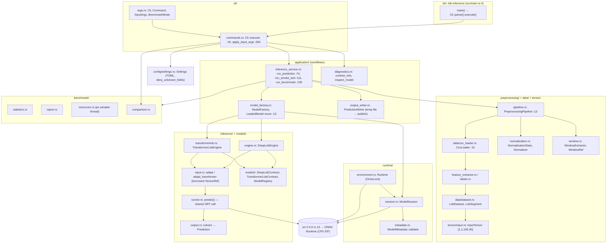

# 02 — Architecture and data flow

The "inference request" here is: **one CSV file (or ordered list of CSV segments) → N non-overlapping 100×40 windows → N ONNX Runtime calls → N rows of 3 class scores**. There is no server/API, tokenizer, autoregressive loop, sampler, or token streaming. "Streaming" exists only as row-by-row writing of the prediction CSV (`src/application/output_writer.rs`).

## 1. Module architecture



Layering rule actually followed in code: `inference/` has no I/O and no config reading (its doc comment: "separate from data loading and application I/O", `src/inference/mod.rs:1`); `application/` is the only layer that sequences load → preprocess → predict → write. One upward dependency: `application/inference_service.rs:12` imports `cli::BenchmarkMode` (application depends on the CLI enum).

## 2. Request flow (one `predict` invocation)

```mermaid
sequenceDiagram
    autonumber
    participant U as User shell
    participant C as Cli::execute<br/>commands.rs:19
    participant S as run_prediction<br/>inference_service.rs:74
    participant R as Runtime / ModelSession<br/>runtime/
    participant F as ModelFactory<br/>model_factory.rs:31
    participant P as PreprocessingPipeline<br/>pipeline.rs
    participant E as DeepLob/TransformerLobEngine
    participant O as ONNX Runtime (ort)
    participant W as PredictionWriter

    U->>C: lob-inference predict --model deeplob --input x.csv
    C->>C: Settings::load + validate (settings.rs:121,145); logging::init
    C->>C: apply_input_args (CLI overrides, :266)
    C->>S: run_prediction(settings, model, ...)
    S->>R: Runtime::initialize("cpu") (OnceLock, environment.rs:25)
    S->>F: load(runtime, settings, model, path)
    F->>R: ModelSession::load → Session::builder().commit_from_file (session.rs:47)
    R->>O: parse ONNX graph, create session
    F->>E: Contract::from_metadata → validate I/O dtype/shape/classes
    S->>P: PreprocessingPipeline::new (requires schema_verified; loads mu/sigma)
    P->>P: CsvLoader::load → Normalizer::normalize → WindowExtractor::extract
    S->>W: PredictionWriter::create (temp file, output_writer.rs:67)
    loop each window i (inference_service.rs:94)
        S->>P: prepared.window(i) → InputTensor::from_window (copy 4000 f32)
        S->>E: model.predict(&tensor)
        E->>E: input::adapt → TensorRef::from_array_view (borrow, no copy)
        E->>O: session.run(inputs![name => tensor]) (runner.rs:19)
        O-->>E: output tensor [*,3] f32
        E->>E: output::extract → Prediction::from_scores (argmax, no softmax)
        S->>W: write(PredictionRow) (CSV serialize)
    end
    S->>W: finish(): flush → fsync → rename / hard_link (output_writer.rs:110)
    W-->>U: "Output written successfully."
```

### Step-by-step with the key symbols

| # | Stage | Function / struct | Evidence |
|---|---|---|---|
| 1 | Entry | `main` → `Cli::parse().execute()`; errors printed via `anyhow` `{:#}` and exit 1 | `src/main.rs:4-9` |
| 2 | Config | `Settings::load` → `parse` (TOML, `deny_unknown_fields`) → `validate` (pins contract to 1×1×100×40, 3 classes, stride 100) | `src/config/settings.rs:121-145` |
| 3 | CLI overrides | `apply_input_args` rewrites `dataset_path`/`segment_paths`/normalization paths then re-validates | `src/cli/commands.rs:266-281` |
| 4 | Runtime | `Runtime::initialize` — process-wide `OnceLock<Result<Environment,String>>`, CPU EP, telemetry off | `src/runtime/environment.rs:8,25-52` |
| 5 | Model load | `ModelFactory::load` → `DeepLobEngine::load` / `TransformerLobEngine::load` → `ModelSession::load` (`Session::builder(env).commit_from_file`) → `ModelMetadata::from_session` | `model_factory.rs:31-51`; `session.rs:34-61`; `metadata.rs:37` |
| 6 | Contract check | `DeepLobContract::from_metadata` / `TransformerLobContract::from_metadata`: 1 input, 1 output, Float32, shape `[-1|1,1,100,40]`, final output axis 3 (dynamic `-1` dims accepted); **names read from graph, not hard-coded** | `src/models/deeplob.rs:20-54`; `src/models/transformerlob.rs:19-57` |
| 7 | "Tokenizer" analogue | `CsvLoader::load_segment`: blank-row pre-scan, `csv::ReaderBuilder` (flexible), per-row `extract_features` (f32 parse, finite check) + `extract_label` (1/2/3 → 0/1/2) | `src/data/csv_loader.rs:33-110,153`; `feature_extractor.rs:6`; `labels.rs:5` |
| 8 | Normalize | `(x − μ)/(σ + 1e-8)` in place, f32; non-finite result → error | `src/preprocessing/normalization.rs:145-167` (formula `:153-154`) |
| 9 | Window | non-overlapping 100-row windows per segment, label = label of window's last row | `src/preprocessing/window.rs:35-` (`label_row` at `:41`) |
| 10 | Tensor | `InputTensor::from_window` copies the `[start*40 .. end*40]` slice into a fresh `Vec<f32>` (4,000 values), validates shape/finite | `src/tensor/input.rs:16-45` |
| 11 | Adapt | `TensorRef::from_array_view((shape, &[f32]))` — borrowed view, no copy; TransformerLOB variant re-checks against live graph shape | `src/inference/input.rs:5-41` |
| 12 | **Forward pass** | `runner::predict` → `session.run(ort::inputs![input_name => input])` → `outputs.get(output_name)` | `src/inference/runner.rs:11-29` |
| 13 | Output parse | `try_extract_tensor::<f32>`; shape must be `[…1,3]`; exactly 3 finite values | `src/inference/output.rs:5-49` |
| 14 | "Sampling" analogue | `Prediction::from_scores`: **greedy argmax** with lowest-index tie-break; scores returned raw (no softmax) | `src/inference/prediction.rs:39-61` |
| 15 | Output/streaming | `PredictionWriter`: CSV rows appended to `.<name>.<pid>.<n>.tmp`; `finish` = flush + `sync_all` + `rename` (overwrite) or `hard_link`+`remove_file` (no-clobber); `Drop` deletes the temp if unpublished | `src/application/output_writer.rs:66-168` |
| 16 | Summary | prints counts; "Failed predictions: 0" is a **literal**, not a counter (any failure aborts earlier) | `src/cli/commands.rs:86` |

### Other entry points (same skeleton)
- `smoke-test`: synthetic all-zero window or first dataset window → one `predict` (`inference_service.rs:111-137`, `synthetic_input_tensor :525`).
- `benchmark`: four modes; in `inference` mode the first window is prepared once and the **same tensor** is fed repeatedly (`inference_service.rs:183-215`); stats via `calculate_latency_statistics`; optional `ps` sampler thread; report metadata (`:355-395`).
- `inspect`/`validate`/`runtime-info`: `diagnostics.rs`.
- `compare`: reads two JSON `BenchmarkReport`s, refuses unless model/mode/EP/shape/dtype/model-hash/runtime-version string match (`benchmark/comparison.rs:26-45`).

## 3. Observations relevant to the paper
- Almost all wall-clock "inference" is inside `session.run`; the Rust code's contribution to latency is: (a) one 16 KB `to_vec` per window (`tensor/input.rs:39`), (b) input validation (`validation.rs:6-27` scans 4,000 floats for finiteness *twice* per call: once in `from_window` and again in `adapt`→`validate`, `input.rs:7`), (c) output extraction, (d) CSV row serialization. None of these has been profiled → [TODO Phase 2: measure Rust-side overhead vs `session.run` alone].
- The CSV loader reads each file **twice** (a raw byte scan for blank lines, `csv_loader.rs:153-203`, then the `csv` reader) and holds the whole dataset in memory (`Vec<f32>` per segment) — fine for FI-2010 scale, not streaming.
