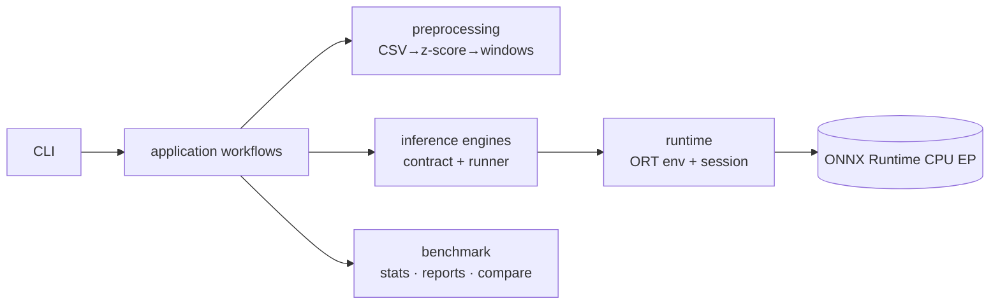
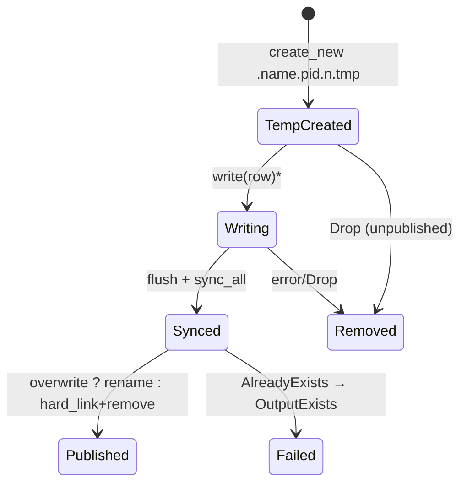

# 05 — Visual candidates

Each entry: purpose · grounding (code/data) · draft. Items marked **[needs Phase-2 data]** can't be finalized yet. No figure below invents numbers; table cells that need measurements are `TBD`.

## F1. System architecture (module diagram)
- **Purpose:** show the layering CLI → application → {preprocessing, inference, runtime} → ORT, and that all numerics sit in ORT.
- **Based on:** `src/lib.rs:5-16`, `02_architecture.md` §1.
- **Draft:** reuse the Mermaid flowchart in `02_architecture.md` §1; for the paper, collapse to 5 boxes:


## F2. End-to-end pipeline with timed boundaries (the key methodology figure)
- **Purpose:** make explicit what each benchmark mode times — the central point for any fair-comparison argument.
- **Based on:** `inference_service.rs:139-329`, `running-a-model.md#8`, `phase-06` (HEAD).
- **Draft (ASCII):**
```
 CSV ─▶ parse+features ─▶ z-score ─▶ windows ─▶ [copy 4000 f32] ─▶ validate ─▶ ORT run ─▶ parse 3 scores ─▶ CSV row
 └──────────── preprocessing mode ───────────────────────────────┘
                                                 └──────── inference mode (per call; SAME tensor reused) ────────┘
 └────────────────────────────── end-to-end mode (in-memory CSV, no disk write) ───────────────────────────────────┘
 load mode:  Session::builder().commit_from_file  (runtime init reported separately)
```
  Note: "inference" mode as implemented includes `adapt`+validation+output parse, *not just* `Session::run` (`:200-201`); the figure must say so. A second variant should add the C++ timer boundary (`Session.Run` only, per deck slide 6) to show the mismatch.

## F3. Request sequence diagram
- **Purpose:** one `predict` call end to end (for a "System design" section).
- **Based on:** `02_architecture.md` §2 (Mermaid sequence diagram already drafted).

## F4. Tensor layout / dataflow of one window
- **Purpose:** show how a 100×40 window maps to the `[1,1,100,40]` tensor and where copies occur.
- **Based on:** `tensor/input.rs:16-45`, `dataset.rs:13-17`, `inference/input.rs:9`; tests asserting `data[40]==40.0` (`inference/input.rs:81`).
- **Draft (ASCII):**
```
 segment.features (rows × 40, f32, row-major)         window i = rows [100i, 100i+100)
 ┌ r0  f0 f1 … f39 ┐                                      │ to_vec()  ← one 16,000-byte copy
 │ r1  …           │  ───────────────────────────────────▶ InputTensor.data[4000]  shape [1,1,100,40]
 │ …               │                                       │ TensorRef::from_array_view (borrow)
 └ rN  …           ┘   labels: segment.labels[100i+99] ──▶ true_class (last row of window)
                                                           ▼
                                                      ORT session.run → [*,3] logits
```

## F5. Window / segment geometry
- **Purpose:** explain non-overlapping windows, label = last row, no crossing of segment (file) boundaries, incomplete tails dropped.
- **Based on:** `window.rs:14,35-70`, `running-a-model.md#3,7`; tests `tests/window_tests.rs`.
- **Draft:** timeline with two segments, window brackets of length 100, label marker at each bracket's last row, and a hatched tail `< 100` rows.

## F6. Contract-validation decision table / flow
- **Purpose:** illustrate C1: what is accepted (static or `-1` dims), what's rejected, and what's *not* guessed (no transpose/pad).
- **Based on:** `metadata.rs:44-133`, `deeplob.rs:73-101`, `transformerlob.rs:76-139`; observed models (`inspect`).
- **Draft (table; fill from tests):**

| Case | Input dims | Output dims | Result | Evidence |
|---|---|---|---|---|
| exact | `[1,1,100,40]` | `[1,3]` | accept | `metadata.rs:158-165` |
| dynamic batch | `[-1,1,100,40]` | `[-1,3]` | accept | `metadata.rs:167-172` |
| vector output | — | `[3]` | accept (DeepLOB) | `deeplob.rs:130` |
| wrong dtype/feature dim/classes | `Float16`, `…39` | `[1,2]` | reject `MetadataValidation` | `metadata.rs:176-194` |
| wrong prefix | — | `[1,3,1]`, `[2,3]` | reject (DeepLOB) | `deeplob.rs:144` |
| rank-3 input | `[1,100,40]` | — | reject (TransformerLOB; no reshape guessed) | `transformerlob.rs:183` |

## F7. Output-publish state machine (small figure for the writer)
- **Purpose:** crash-safe publish semantics.
- **Based on:** `output_writer.rs:66-168`.
- **Draft:**


## F8. Latency distribution figure **[needs Phase-2 data]**
- **Purpose:** show tail behaviour; CDF/violin of per-call latency per runtime and model; overlay per-trial medians to expose between-trial drift.
- **Based on:** `BenchmarkReport.trials[].samples_ms` (`report.rs:15-24`). Today's only data: `outputs/benchmarks/presentation-translob-next.json` → per-trial means 3.95/10.71/5.54/16.35/2.44 ms (`04_paper_evidence.md` §2a) — good as a *motivating "noisy run" panel* for why trial isolation and thermal control matter, but not as a result.

## F9. Comparability matrix (Rust vs C++ vs paper) — table
- **Purpose:** show which experimental factors differ across the three numbers in the deck.
- **Based on:** `ppt/index.html` slide 6; IEEE PDF Table III; `comparison.rs:26-45`.

| Factor | Rust run | Fresh C++ run | Paper C++ |
|---|---|---|---|
| Mean latency (ms) | 1.785 (deck; **unreproduced**, M-6) | 0.854 (deck) | 1.159 (Table III) |
| ORT version | 1.31 (string) | 1.24.4 | [UNCLEAR] |
| Threads | ORT default | 1 | [UNCLEAR] |
| Input | CSV-derived | synthetic | [UNCLEAR] |
| Timed boundary | Rust `predict` | `Session.Run` | [UNCLEAR] |
| Machine | Apple M3, 8 GB | Apple M3 | [UNCLEAR] |
Highlight rows that would make `compare` refuse (version) vs those it can't see (threads, input, boundary).

## F10. Evidence-gap / claim-support table
- **Purpose:** honest "what's measured vs. what's designed" table for a limitations section; derive from `04_paper_evidence.md` §1 and §3 (claim · evidence · status).

## F11. Quantization block format, KV-cache layout, SIMD kernel diagram, threading model — **not applicable**
- None of these exist (`03_subsystems.md` §3–6). A *threading* figure could only show: single-threaded Rust sequential loop + ORT's internal pool (defaults, unmeasured) + optional `ps` sampler thread (`resources.rs:37`). Not worth a figure until thread counts are exposed and swept (Phase 2).

## F12. Model I/O contract box (small, for the paper's "setup" section)
```
 input : float32 [N,1,100,40]   (N dynamic in both committed models; engine sends N=1)
 output: float32 [N,3] (DeepLOB, dynamic) / [1,3] (TransformerLOB, static)   → logits, class 0=Down 1=Stationary 2=Up
```
Source: `inspect` output (2026-11-22), `labels.rs:19-26`.
