# Phase 2 benchmark summary — run `20261122-final-rust-vs-cpp`

- Machine: Apple M3 ({'p_cores': '4', 'e_cores': '4'}), 8 GiB; ProductName:		macOS ProductVersion:		26.5.2 BuildVersion:		25F84
- Power: Now drawing from 'Battery Power' /  -InternalBattery-0 (id=21954659)	55%; discharging; 5:03 remaining present: true; Low Power Mode: off
- Load average: before { 2.83 2.32 2.38 }, after { 1.29 1.62 1.96 }
- Git: `bdd807f9a8` on `feat/phase2-benchmarking`; dirty files present: yes
- Rust runtime: ['ONNX Runtime build: ORT Build Info: git-branch=rel-1.31.0, git-commit-id=402979a, fp8-kv-cache=1, build type=Release']; Python onnxruntime 1.32.0
- Protocol: 15 isolated processes per configuration, 20 warm-up + 200 timed calls each, randomized interleaved order (seed 20261122), 1.0 s cool-down. Duration 665 s.
- Failed runs: 0

## Latency

Per-process medians fall into two clusters ~1.7x apart ("slow mode": median > 1.3x the fastest process of the same engine and configuration). Primary statistic: fast-mode median with 95% bootstrap CI over processes; all-process median for reference. Pooled tails include every process.

| Model | Engine | Threads | Input | Graph opt | Fast-mode median ms [95% CI] | Slow-mode procs | All-proc median | P99 ms | P99.9 ms | Session.run P50 ms | Host overhead P50 µs | Throughput /s |
|---|---|---|---|---|---|---|---|---|---|---|---|---|
| DeepLOB | cpp | 1 | cycle | default | 0.674 [0.673, 0.675] | 0/15 | 0.674 | 0.843 | 1.153 | 0.675 | 0.4 | 1467 |
| DeepLOB | cpp | 1 | first | default | 0.672 [0.668, 0.678] | 0/15 | 0.672 | 0.771 | 0.808 | 0.673 | 0.3 | 1474 |
| DeepLOB | cpp | default | cycle | default | 0.275 [0.275, 0.276] | 0/15 | 0.275 | 0.368 | 0.510 | 0.275 | 0.4 | 3488 |
| DeepLOB | cpp | default | first | default | 0.275 [0.274, 0.276] | 0/15 | 0.275 | 0.398 | 0.461 | 0.275 | 0.4 | 3475 |
| DeepLOB | rust | 1 | cycle | all | 0.691 [0.690, 0.694] | 0/7 | 0.691 | 0.737 | 0.757 | 0.690 | 1.8 | 1441 |
| DeepLOB | rust | 1 | cycle | default | 0.691 [0.691, 0.692] | 0/15 | 0.691 | 0.743 | 0.845 | 0.690 | 1.8 | 1444 |
| DeepLOB | rust | 1 | cycle | disable | 0.763 [0.761, 0.768] | 0/7 | 0.763 | 0.818 | 0.868 | 0.762 | 1.8 | 1309 |
| DeepLOB | rust | 1 | first | default | 0.691 [0.691, 0.694] | 0/15 | 0.691 | 0.794 | 0.845 | 0.691 | 1.5 | 1444 |
| DeepLOB | rust | default | cycle | default | 0.318 [0.317, 0.318] | 0/15 | 0.318 | 0.349 | 0.423 | 0.316 | 1.8 | 3139 |
| DeepLOB | rust | default | first | default | 0.317 [0.317, 0.318] | 0/15 | 0.317 | 0.355 | 0.465 | 0.316 | 1.5 | 3142 |
| DeepLOB | rust-coreml | 1 | cycle | default | 0.797 [0.794, 0.798] | 0/15 | 0.797 | 0.881 | 0.925 | 0.794 | 1.9 | 1244 |
| DeepLOB | rust-coreml | default | cycle | default | 0.794 [0.791, 0.796] | 0/15 | 0.794 | 0.883 | 0.961 | 0.791 | 1.9 | 1253 |
| DeepLOB | rust-msdylib | 1 | cycle | default | 0.667 [0.666, 0.668] | 0/15 | 0.667 | 0.689 | 0.707 | 0.665 | 1.9 | 1498 |
| DeepLOB | rust-msdylib | default | cycle | default | 0.275 [0.274, 0.275] | 0/15 | 0.275 | 0.324 | 0.553 | 0.273 | 1.9 | 3627 |
| TransformerLOB | cpp | 1 | cycle | default | 0.897 [0.895, 0.897] | 0/15 | 0.897 | 0.958 | 0.995 | 0.897 | 0.3 | 1112 |
| TransformerLOB | cpp | 1 | first | default | 0.897 [0.895, 0.899] | 0/15 | 0.897 | 0.973 | 1.004 | 0.897 | 0.3 | 1111 |
| TransformerLOB | cpp | default | cycle | default | 0.336 [0.335, 0.337] | 0/15 | 0.336 | 0.534 | 0.777 | 0.336 | 0.4 | 2924 |
| TransformerLOB | cpp | default | first | default | 0.335 [0.335, 0.337] | 0/15 | 0.335 | 0.409 | 0.496 | 0.336 | 0.4 | 2935 |
| TransformerLOB | rust | 1 | cycle | all | 0.914 [0.913, 0.915] | 0/7 | 0.914 | 0.937 | 0.961 | 0.912 | 1.8 | 1091 |
| TransformerLOB | rust | 1 | cycle | default | 0.914 [0.913, 0.919] | 0/15 | 0.914 | 0.998 | 1.468 | 0.914 | 1.8 | 1092 |
| TransformerLOB | rust | 1 | cycle | disable | 1.011 [1.009, 1.014] | 0/7 | 1.011 | 1.095 | 1.125 | 1.010 | 1.8 | 988 |
| TransformerLOB | rust | 1 | first | default | 0.914 [0.913, 0.918] | 0/15 | 0.914 | 0.963 | 0.985 | 0.914 | 1.5 | 1092 |
| TransformerLOB | rust | default | cycle | default | 0.520 [0.518, 0.523] | 0/15 | 0.520 | 0.543 | 0.560 | 0.518 | 2.2 | 1919 |
| TransformerLOB | rust | default | first | default | 0.519 [0.517, 0.522] | 0/15 | 0.519 | 0.544 | 0.558 | 0.517 | 1.8 | 1923 |
| TransformerLOB | rust-coreml | 1 | cycle | default | 1.770 [1.763, 1.778] | 0/15 | 1.770 | 1.928 | 1.974 | 1.768 | 2.0 | 562 |
| TransformerLOB | rust-coreml | default | cycle | default | 1.767 [1.762, 1.771] | 0/15 | 1.767 | 1.927 | 1.990 | 1.763 | 2.0 | 563 |
| TransformerLOB | rust-msdylib | 1 | cycle | default | 0.890 [0.890, 0.894] | 0/15 | 0.890 | 0.959 | 0.990 | 0.889 | 1.9 | 1121 |
| TransformerLOB | rust-msdylib | default | cycle | default | 0.338 [0.337, 0.338] | 0/15 | 0.338 | 0.360 | 0.512 | 0.336 | 1.9 | 2960 |

## Engine comparison vs Rust (fast-mode per-process medians; Mann–Whitney U; ratio > 1 ⇒ slower than Rust)

| Model | Threads | Input | Engine | n (fast) | Ratio [95% CI] | p | Slow-mode share engine / rust (Fisher p) | All-process ratio (p) |
|---|---|---|---|---|---|---|---|---|
| DeepLOB | 1 | first | cpp | 15 vs 15 | 0.972 [0.967, 0.980] | 3.4e-06 | 0/15 / 0/15 (1.00) | 0.972 (3.4e-06) |
| DeepLOB | 1 | cycle | cpp | 15 vs 15 | 0.975 [0.973, 0.995] | 0.00058 | 0/15 / 0/15 (1.00) | 0.975 (0.00058) |
| DeepLOB | 1 | cycle | rust-msdylib | 15 vs 15 | 0.965 [0.963, 0.967] | 3.4e-06 | 0/15 / 0/15 (1.00) | 0.965 (3.4e-06) |
| DeepLOB | 1 | cycle | rust-coreml | 15 vs 15 | 1.153 [1.146, 1.154] | 3.4e-06 | 0/15 / 0/15 (1.00) | 1.153 (3.4e-06) |
| DeepLOB | default | first | cpp | 15 vs 15 | 0.866 [0.862, 0.870] | 3.4e-06 | 0/15 / 0/15 (1.00) | 0.866 (3.4e-06) |
| DeepLOB | default | cycle | cpp | 15 vs 15 | 0.866 [0.864, 0.869] | 3.4e-06 | 0/15 / 0/15 (1.00) | 0.866 (3.4e-06) |
| DeepLOB | default | cycle | rust-msdylib | 15 vs 15 | 0.865 [0.863, 0.868] | 3.4e-06 | 0/15 / 0/15 (1.00) | 0.865 (3.4e-06) |
| DeepLOB | default | cycle | rust-coreml | 15 vs 15 | 2.499 [2.489, 2.507] | 3.4e-06 | 0/15 / 0/15 (1.00) | 2.499 (3.4e-06) |
| TransformerLOB | 1 | first | cpp | 15 vs 15 | 0.982 [0.977, 0.983] | 0.00049 | 0/15 / 0/15 (1.00) | 0.982 (0.00049) |
| TransformerLOB | 1 | cycle | cpp | 15 vs 15 | 0.981 [0.975, 0.982] | 5.1e-06 | 0/15 / 0/15 (1.00) | 0.981 (5.1e-06) |
| TransformerLOB | 1 | cycle | rust-msdylib | 15 vs 15 | 0.974 [0.968, 0.976] | 0.00026 | 0/15 / 0/15 (1.00) | 0.974 (0.00026) |
| TransformerLOB | 1 | cycle | rust-coreml | 15 vs 15 | 1.936 [1.922, 1.943] | 3.4e-06 | 0/15 / 0/15 (1.00) | 1.936 (3.4e-06) |
| TransformerLOB | default | first | cpp | 15 vs 15 | 0.645 [0.642, 0.650] | 3.4e-06 | 0/15 / 0/15 (1.00) | 0.645 (3.4e-06) |
| TransformerLOB | default | cycle | cpp | 15 vs 15 | 0.645 [0.642, 0.648] | 3.4e-06 | 0/15 / 0/15 (1.00) | 0.645 (3.4e-06) |
| TransformerLOB | default | cycle | rust-msdylib | 15 vs 15 | 0.649 [0.646, 0.652] | 3.4e-06 | 0/15 / 0/15 (1.00) | 0.649 (3.4e-06) |
| TransformerLOB | default | cycle | rust-coreml | 15 vs 15 | 3.394 [3.376, 3.414] | 3.4e-06 | 0/15 / 0/15 (1.00) | 3.394 (3.4e-06) |

All engines link ONNX Runtime 1.31.0 built from commit 402979a (Rust: bundled `ort` build; `python` and `rust-msdylib`: Microsoft's official build), so ratios isolate engine/binary/configuration, not ORT version.

## Cold start (process wall time, spawn → first prediction → exit)

| Model | Engine | n | Median ms [95% CI] | Min | Max |
|---|---|---|---|---|---|
| deeplob | rust | 15 | 36.9 [29.4, 40.5] | 23.7 | 41.0 |
| deeplob | cpp | 15 | 42.4 [38.2, 49.6] | 32.6 | 113.1 |
| deeplob | rust-coreml | 15 | 117.2 [111.9, 127.8] | 101.8 | 129.2 |
| transformerlob | rust | 15 | 50.7 [43.8, 51.9] | 32.5 | 53.5 |
| transformerlob | cpp | 15 | 55.4 [45.7, 61.3] | 33.8 | 141.1 |
| transformerlob | rust-coreml | 15 | 442.2 [427.7, 447.7] | 412.4 | 472.5 |

## Rust preprocessing stages (full test set)

| Stage | n | Median ms | Min | Max |
|---|---|---|---|---|
| CSV parse + feature extraction | 7 | 95.945 | 94.560 | 105.667 |
| Z-score normalization | 7 | 0.577 | 0.553 | 0.603 |
| Window generation | 7 | 0.008 | 0.006 | 0.011 |
| Tensor construction (319 windows) | 7 | 0.478 | 0.477 | 0.495 |

## Rust end-to-end (CSV → predictions serialized in memory)

| Model | n | Windows | Median total ms | Per window ms | Throughput windows/s |
|---|---|---|---|---|---|
| DeepLOB | 7 | 319 | 200.8 | 0.629 | 1589 |
| TransformerLOB | 7 | 319 | 265.6 | 0.833 | 1201 |

## Numerical equivalence (all windows × 3 logits; reference = C++ (ORT C++ API), 1 thread)

| Model | Engine | Threads | Max abs diff | Mean abs diff | ≤ 1e-5 | Bit-identical | Argmax agreement |
|---|---|---|---|---|---|---|---|
| deeplob | cpp | default | 5.44e-06 | 4.93e-07 | True | False | 100.0% |
| transformerlob | cpp | default | 8.34e-07 | 1.11e-07 | True | False | 100.0% |
| deeplob | rust | 1 | 0.00e+00 | 0.00e+00 | True | True | 100.0% |
| deeplob | rust | default | 5.44e-06 | 4.93e-07 | True | False | 100.0% |
| transformerlob | rust | 1 | 0.00e+00 | 0.00e+00 | True | True | 100.0% |
| transformerlob | rust | default | 8.34e-07 | 1.11e-07 | True | False | 100.0% |
| deeplob | rust-coreml | 1 | 3.02e-03 | 5.36e-04 | False | False | 100.0% |
| deeplob | rust-coreml | default | 3.02e-03 | 5.36e-04 | False | False | 100.0% |
| transformerlob | rust-coreml | 1 | 9.48e-04 | 1.47e-04 | False | False | 100.0% |
| transformerlob | rust-coreml | default | 9.48e-04 | 1.47e-04 | False | False | 100.0% |
| deeplob | rust-msdylib | 1 | 0.00e+00 | 0.00e+00 | True | True | 100.0% |
| deeplob | rust-msdylib | default | 5.44e-06 | 4.93e-07 | True | False | 100.0% |
| transformerlob | rust-msdylib | 1 | 0.00e+00 | 0.00e+00 | True | True | 100.0% |
| transformerlob | rust-msdylib | default | 8.34e-07 | 1.11e-07 | True | False | 100.0% |

## Model quality on the 319 test windows (1 thread)

| Model | Engine | Accuracy | Macro-F1 | Recall Down / Stat / Up | Majority-class accuracy |
|---|---|---|---|---|---|
| deeplob | cpp | 57.7% | 0.335 | 19.0% / 78.1% / 4.8% | 68.7% |
| transformerlob | cpp | 22.3% | 0.224 | 48.3% / 12.3% / 38.1% | 68.7% |
| deeplob | rust | 57.7% | 0.335 | 19.0% / 78.1% / 4.8% | 68.7% |
| transformerlob | rust | 22.3% | 0.224 | 48.3% / 12.3% / 38.1% | 68.7% |
| deeplob | rust-coreml | 57.7% | 0.335 | 19.0% / 78.1% / 4.8% | 68.7% |
| transformerlob | rust-coreml | 22.3% | 0.224 | 48.3% / 12.3% / 38.1% | 68.7% |
| deeplob | rust-msdylib | 57.7% | 0.335 | 19.0% / 78.1% / 4.8% | 68.7% |
| transformerlob | rust-msdylib | 22.3% | 0.224 | 48.3% / 12.3% / 38.1% | 68.7% |

## ONNX Runtime node placement (from ORT trace logs)

| Engine | Model | CoreML nodes | Placements |
|---|---|---|---|
| rust | deeplob | 0 | `{"CPUExecutionProvider": "all (single provider)"}` |
| rust | transformerlob | 0 | `{"CPUExecutionProvider": "all (single provider)"}` |
| rust-coreml | deeplob | 2 | `{"CoreMLExecutionProvider": 2, "CPUExecutionProvider": 5}` |
| rust-coreml | transformerlob | 14 | `{"CoreMLExecutionProvider": 14, "CPUExecutionProvider": 37}` |
| rust-msdylib | deeplob | 0 | `{"CPUExecutionProvider": "all (single provider)"}` |
| rust-msdylib | transformerlob | 0 | `{"CPUExecutionProvider": "all (single provider)"}` |

## Engines

- `rust`: Rust lob-inference, bundled static ORT 1.31.0, device policy cpu
- `python`: Python onnxruntime 1.31.0 (PyPI wheel, version-matched)
- `rust-coreml`: Rust lob-inference, ort-crate default MaxEfficiency policy (CoreML offload)
- `rust-msdylib`: Rust lob-inference (ort-dynamic) + Microsoft libonnxruntime 1.31.0 dylib
- `python-ort132`: Python onnxruntime 1.32.0 (numerics only)
- `cpp`: C++ (bench/cpp adapter of cpp-engine/cpp_inference): ORT C++ API, Microsoft ONNX Runtime 1.31.0 SDK (NuGet osx-arm64)

## Figures

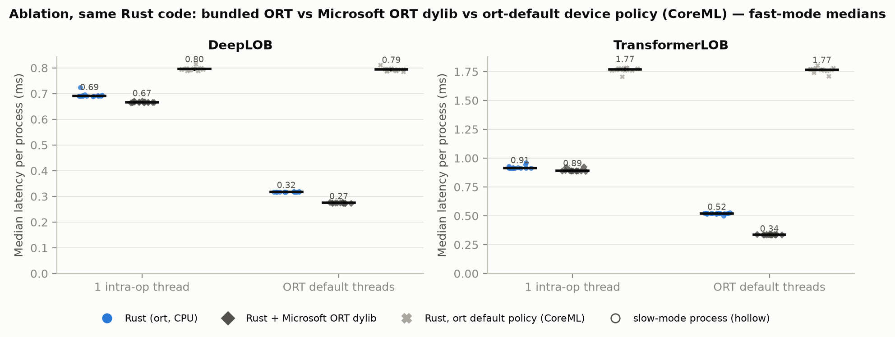
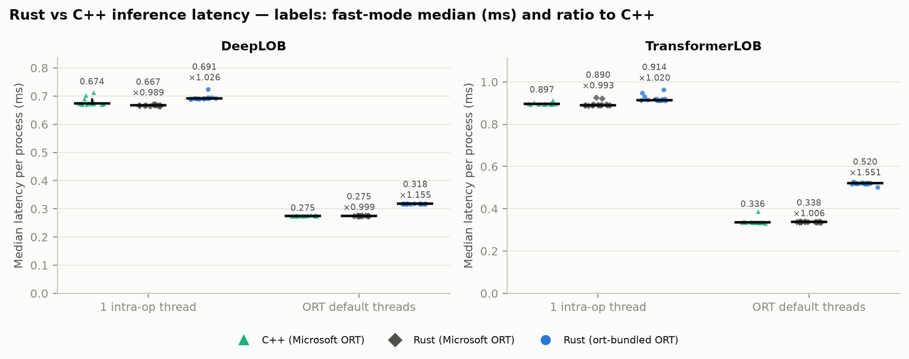
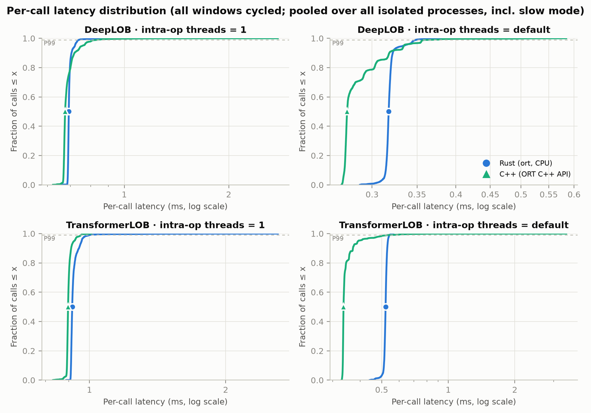
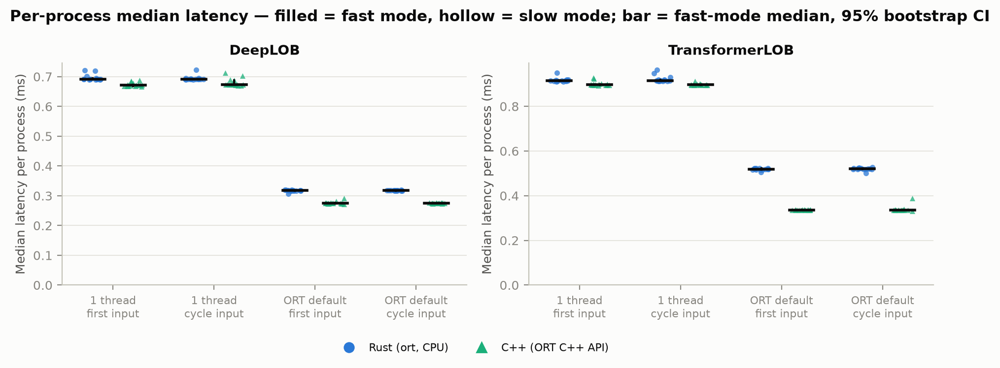
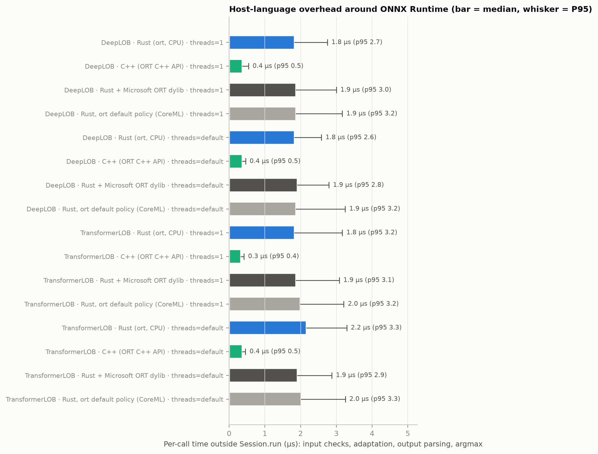
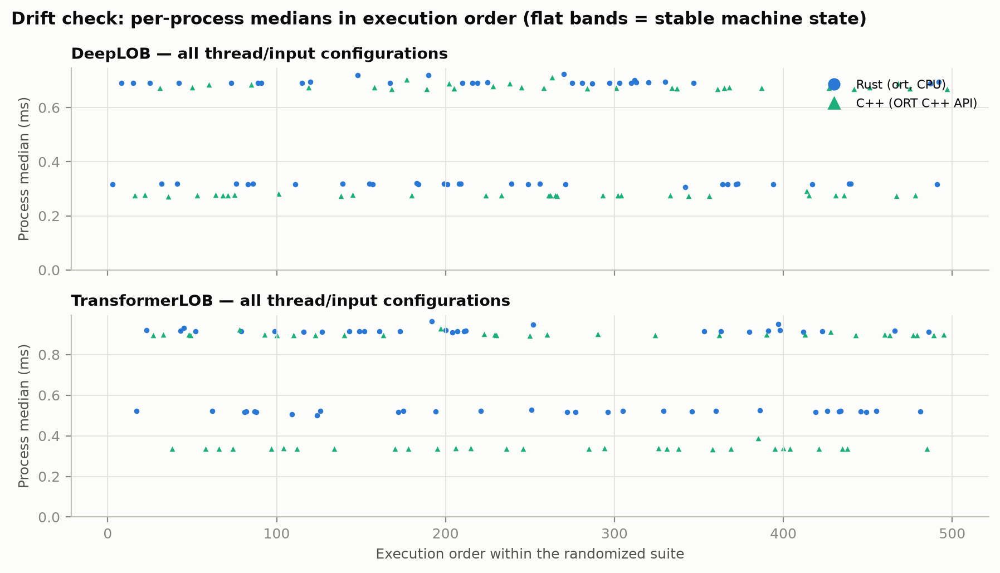
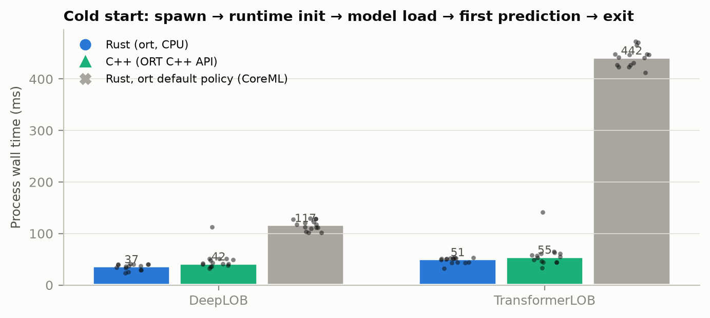
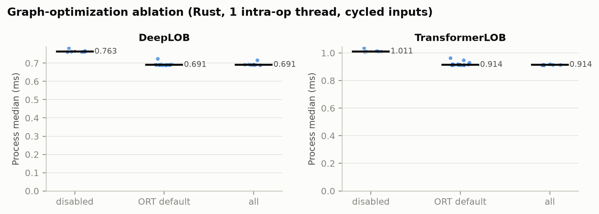
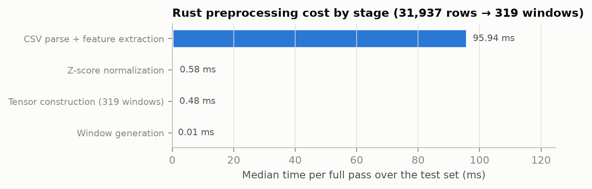
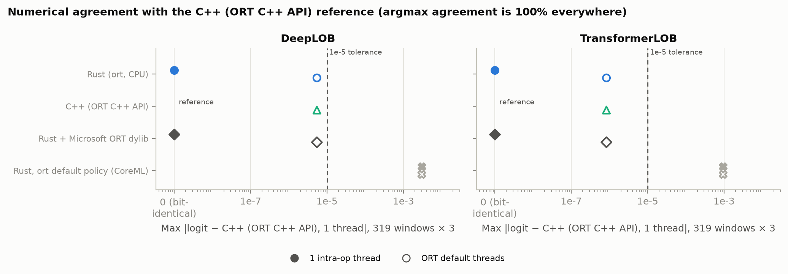
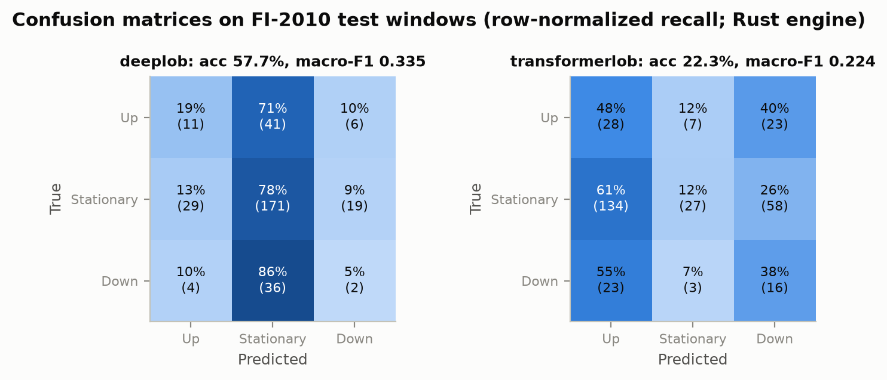

Tables (CSV, the table view for every figure): `tables/accuracy.csv`, `tables/cold_start.csv`, `tables/device_binary_ablation.csv`, `tables/end_to_end.csv`, `tables/engine_comparison.csv`, `tables/graph_opt_ablation.csv`, `tables/headline_rust_vs_cpp.csv`, `tables/latency_by_config.csv`, `tables/node_placement.csv`, `tables/numerical_equivalence.csv`, `tables/preprocessing_stages.csv`, `tables/same_binary_rust_vs_cpp.csv`
